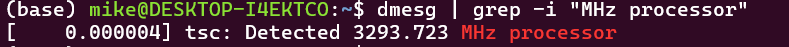
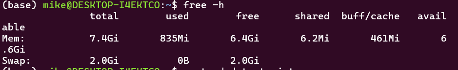
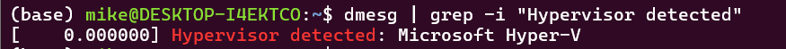
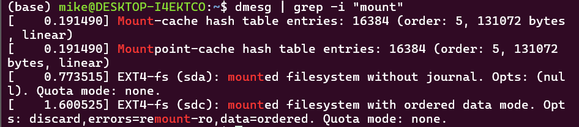

---
## Author
author:
  name: Давид Майкл Фрэнсис
  affiliation:
    - name: Российский университет дружбы народов
      country: Российская Федерация
      postal-code: 117198
      city: Москва
      address: ул. Миклухо-Маклая, д. 6
## Title
title: Лабораторная работа №1
subtitle: Установка операционной системы Linux. Анализ последовательности загрузки системы
license: CC BY
---

# Информация

## Докладчик

  * Давид Майкл Фрэнсис
  * Студент направления «Математика и компьютерные науки»
  * Российский университет дружбы народов
  * <https://ushie47.github.io/blog>

# Вводная часть

## Цель работы

Приобретение практических навыков установки операционной системы на виртуальную машину, настройки минимально необходимых для дальнейшей работы сервисов.

## Задание

Проанализировать последовательность загрузки системы с помощью команды `dmesg` и получить:

1. Версию ядра Linux.
2. Частоту и модель процессора.
3. Объём доступной оперативной памяти.
4. Тип обнаруженного гипервизора.
5. Тип файловой системы корневого раздела.
6. Последовательность монтирования файловых систем.

# Выполнение работы

## Журнал загрузки системы

Я открыл терминал и просмотрел журнал загрузки командой `dmesg | less`.

## Версия ядра Linux

Версию ядра я нашёл командой `dmesg | grep -i "Linux version"`.

## Частота процессора

Частоту процессора я нашёл командой `dmesg | grep -i "MHz processor"`.

## Модель процессора

Модель процессора я нашёл командой `dmesg | grep -i "CPU0"`.

## Оперативная память

Объём доступной памяти я нашёл командой `dmesg | grep -i "Memory available"`.

## Гипервизор

Тип гипервизора я нашёл командой `dmesg | grep -i "Hypervisor detected"`.

## Файловая система корневого раздела

Тип файловой системы корневого раздела я нашёл командой `dmesg | grep -i "filesystem"`.

## Последовательность монтирования

Последовательность монтирования файловых систем я получил командой `dmesg | grep -i "mount"`.

# Результаты

## Выводы

::: {.nonincremental}

- Проанализирован журнал загрузки системы командой `dmesg`
- Получены версия ядра, частота и модель процессора, объём памяти
- Определены тип гипервизора и файловая система корневого раздела
- Получена последовательность монтирования файловых систем

:::
