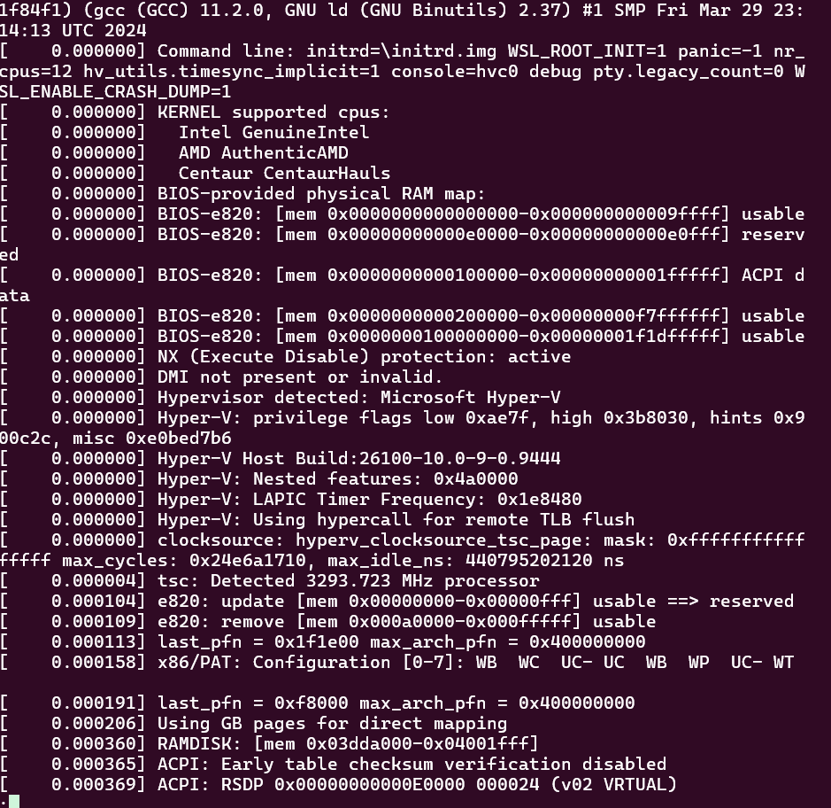
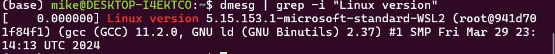
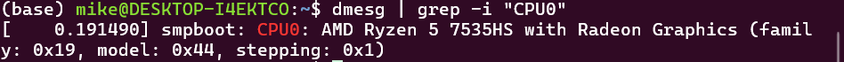
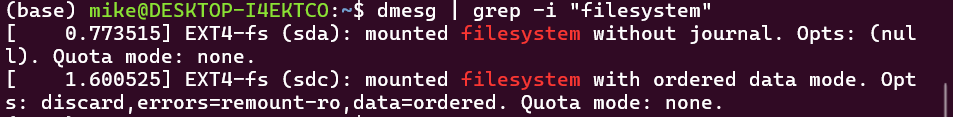

---
## Author
author:
  name: Давид Майкл Фрэнсис
  affiliation:
    - name: Российский университет дружбы народов
      country: Российская Федерация
      postal-code: 117198
      city: Москва
      address: ул. Миклухо-Маклая, д. 6

## Title
title: "Лабораторная работа №1"
subtitle: "Установка операционной системы Linux. Анализ последовательности загрузки системы"
license: "CC BY"
abstract: |
  В данном отчёте представлены результаты выполнения домашнего задания лабораторной работы по теме «Установка операционной системы Linux».

  Выполнен анализ последовательности загрузки системы с помощью команды `dmesg`: определены версия ядра Linux, частота и модель процессора, объём доступной оперативной памяти, тип обнаруженного гипервизора, тип файловой системы корневого раздела и последовательность монтирования файловых систем.

  Даны ответы на контрольные вопросы.
keywords: [linux, ubuntu, dmesg, загрузка системы, файловая система]
---

# Введение

## Актуальность

После установки операционной системы необходимо уметь проверить, как именно она загрузилась и на каком оборудовании работает. Журнал сообщений ядра, доступный через команду `dmesg`, — основной источник такой информации: из него можно узнать версию ядра, параметры процессора и памяти, наличие гипервизора и порядок монтирования файловых систем. Эти навыки необходимы при диагностике неполадок и настройке системы.

## Цель работы

Приобретение практических навыков установки операционной системы на виртуальную машину, настройки минимально необходимых для дальнейшей работы сервисов.

## Задачи

Операционная система Ubuntu была установлена заранее, поэтому в отчёте рассматривается домашнее задание. В рамках него необходимо:

- проанализировать последовательность загрузки системы с помощью команды `dmesg`;
- получить версию ядра Linux;
- определить частоту и модель процессора;
- определить объём доступной оперативной памяти;
- определить тип обнаруженного гипервизора;
- определить тип файловой системы корневого раздела;
- определить последовательность монтирования файловых систем;
- ответить на контрольные вопросы.

## Объект и предмет исследования

Объектом исследования является операционная система Linux (дистрибутив Ubuntu). Предметом исследования выступает последовательность загрузки системы, отражённая в журнале сообщений ядра, и сведения об оборудовании и файловых системах, которые можно из неё получить.

## Методы исследования

Работа выполнялась практическим методом — путём анализа вывода команды `dmesg` в терминале с использованием фильтрации (`grep`) и постраничного просмотра (`less`).

## Схема выполнения работы

На рис. -@fig-flowchart представлена общая последовательность действий при выполнении работы.

::: {#fig-flowchart}

```{mermaid}
%%| fig-width: 100%
graph TD
    A@{ shape: circle, label: "Начало" } --> B[Выполнить действие]
    B --> C[Описать, что конкретно сделано]
    C --> D[Подтвердить скриншотом]
    D --> E[Занести в отчёт]
    E --> F[Поместить в git-репозиторий]
    F --> G[Сделать релиз git]
    G --> J@{ shape: dbl-circ, label: "Конец" }
```

Блок-схема выполнения лабораторной работы

:::

# Теоретическая часть

Во время загрузки ядро Linux выводит диагностические сообщения: об обнаруженном оборудовании, инициализации подсистем и монтировании файловых систем. Эти сообщения сохраняются в кольцевом буфере ядра, содержимое которого выводит команда `dmesg` [@nemeth_book_unix-linux-admin_en]. Поскольку вывод команды велик, его обычно просматривают постранично через `less` или фильтруют по ключевым словам командой `grep` [@robbins_book_bash-pocket-reference_en]. Для поиска без учёта регистра используется ключ `-i`.

В журнале загрузки содержатся сведения о платформе, на которой работает система. Так, строка «Hypervisor detected» показывает, что система запущена под управлением гипервизора, то есть в виртуальной машине: гипервизор — программа, создающая и запускающая виртуальные машины и распределяющая между ними ресурсы физического компьютера [@dash_book_virtualbox_en; @colvin_book_virtualbox-guide_en].

**Файловая система** — это способ организации и хранения данных на носителе. Чтобы содержимое файловой системы стало доступным, её необходимо смонтировать, то есть подключить к определённому каталогу общего дерева каталогов [@robachevsky_book_unix_ru; @kolisnichenko_book_linux-admin_ru]. Корневая файловая система монтируется первой при загрузке, а остальные — после неё; порядок и тип монтируемых файловых систем также отражаются в журнале ядра.

# Материалы и методы

Для выполнения работы использовались операционная система Ubuntu и команды `dmesg`, `grep` и `less`.

# Выполнение лабораторной работы

После загрузки графической среды был открыт терминал. Для анализа последовательности загрузки системы была выполнена команда `dmesg`; для удобства её вывод просматривался постранично (рис. -@fig-001):

```bash
dmesg | less
```

{#fig-001 width=70%}

Для поиска конкретных сведений в журнале использовалась фильтрация по ключевым словам с помощью `grep` с ключом `-i` (без учёта регистра):

```bash
dmesg | grep -i "то, что ищем"
```

## Версия ядра Linux

Версия ядра Linux была определена по строке «Linux version» (рис. -@fig-002):

```bash
dmesg | grep -i "Linux version"
```

{#fig-002 width=70%}

## Процессор

Частота процессора была найдена по строке «MHz processor» (рис. -@fig-003), а модель процессора — по строке «CPU0» (рис. -@fig-004):

```bash
dmesg | grep -i "MHz processor"
dmesg | grep -i "CPU0"
```

{#fig-003 width=70%}

{#fig-004 width=70%}

## Оперативная память

Объём доступной оперативной памяти был определён по строке «Memory available» (рис. -@fig-005):

```bash
dmesg | grep -i "Memory available"
```

{#fig-005 width=70%}

## Гипервизор

Тип обнаруженного гипервизора был определён по строке «Hypervisor detected» (рис. -@fig-006):

```bash
dmesg | grep -i "Hypervisor detected"
```

{#fig-006 width=70%}

## Файловая система

Тип файловой системы корневого раздела был определён из сообщений ядра о монтировании (рис. -@fig-007):

```bash
dmesg | grep -i "filesystem"
```

{#fig-007 width=70%}

Последовательность монтирования файловых систем была получена из тех же сообщений ядра (рис. -@fig-008):

```bash
dmesg | grep -i "mount"
```

{#fig-008 width=70%}

# Результаты

В результате выполнения домашнего задания был проанализирован журнал загрузки системы и получены следующие сведения:

| Параметр | Результат |
|---|---|
| Версия ядра Linux | рис. -@fig-002 |
| Частота процессора | рис. -@fig-003 |
| Модель процессора | рис. -@fig-004 |
| Объём доступной оперативной памяти | рис. -@fig-005 |
| Тип обнаруженного гипервизора | рис. -@fig-006 |
| Тип файловой системы корневого раздела | рис. -@fig-007 |
| Последовательность монтирования файловых систем | рис. -@fig-008 |

# Обсуждение результатов

Журнал сообщений ядра оказался удобным единым источником сведений о системе: все перечисленные параметры были получены одной командой `dmesg` с различными фильтрами `grep`, без установки дополнительных программ. Следует учитывать, что формулировки сообщений ядра могут отличаться в разных версиях ядра и дистрибутивах, поэтому ключевые слова для поиска иногда приходится подбирать по общему выводу `dmesg | less`.

# Заключение

В ходе выполнения домашнего задания был выполнен анализ последовательности загрузки системы с помощью команды `dmesg`. Получены версия ядра Linux, частота и модель процессора, объём доступной оперативной памяти, тип обнаруженного гипервизора, тип файловой системы корневого раздела и последовательность монтирования файловых систем. Приобретены практические навыки работы с журналом сообщений ядра и фильтрации вывода командой `grep`.

Поставленная цель работы достигнута.

# Ответы на контрольные вопросы {.unnumbered}

**1. Какая информация содержится в учётной записи пользователя?**

Учётная запись пользователя содержит:

- имя пользователя (логин);
- пароль (в системе хранится в виде хэша);
- числовой идентификатор пользователя (UID);
- числовой идентификатор основной группы (GID);
- полное имя или комментарий;
- домашний каталог;
- командную оболочку, запускаемую при входе.

Эти сведения хранятся в файлах `/etc/passwd` и `/etc/shadow`, а принадлежность пользователя к группам — в файле `/etc/group`.

**2. Укажите команды терминала и приведите примеры**

- Получение справки по команде: `man ls`, `ls --help`;
- перемещение по файловой системе: `cd /home/user`, `cd ..`, `pwd`;
- просмотр содержимого каталога: `ls -la`;
- определение размера каталога: `du -sh ~/каталог`;
- создание и удаление каталогов и файлов: `mkdir dir`, `touch file.txt`, `rmdir dir`, `rm file.txt`, `rm -r dir`;
- установка прав доступа к файлу или каталогу: `chmod 755 file`, `chmod u+x file`;
- просмотр истории команд: `history`.

**3. Что такое файловая система? Приведите примеры с кратким описанием**

Файловая система — способ организации и хранения данных на носителе информации. Примеры:

- **ext4** — журналируемая файловая система, используемая по умолчанию во многих дистрибутивах Linux, в том числе в Ubuntu;
- **XFS** — журналируемая файловая система, рассчитанная на большие файлы и разделы, используется по умолчанию в Fedora и RHEL;
- **Btrfs** — файловая система с поддержкой снимков и контроля целостности данных;
- **vfat (FAT32)** — простая файловая система, используемая на EFI-разделах и съёмных носителях;
- **NTFS** — файловая система Windows, поддерживаемая в Linux.

**4. Как посмотреть, какие файловые системы смонтированы в ОС?**

```bash
mount
findmnt
df -hT
lsblk -f
```

**5. Как удалить зависший процесс?**

```bash
# Найти идентификатор процесса
ps aux | grep имя_процесса
# Завершить процесс по PID
kill PID
# Принудительно завершить, если обычный kill не помогает
kill -9 PID
# Завершить процесс по имени
killall имя_процесса
```

# Список литературы {.unnumbered}

::: {#refs}
:::

