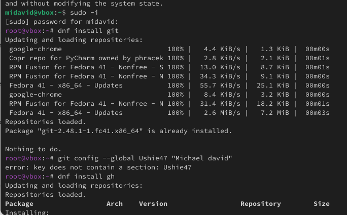
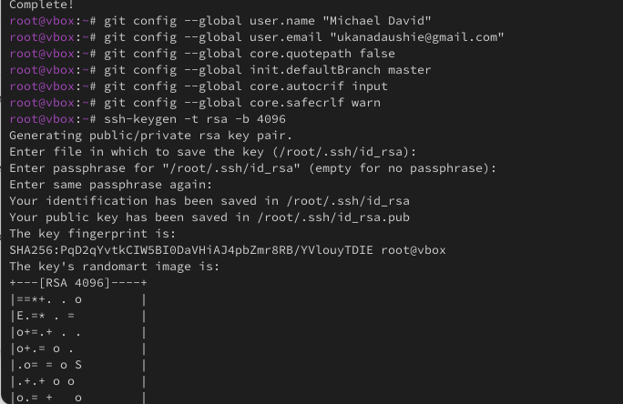
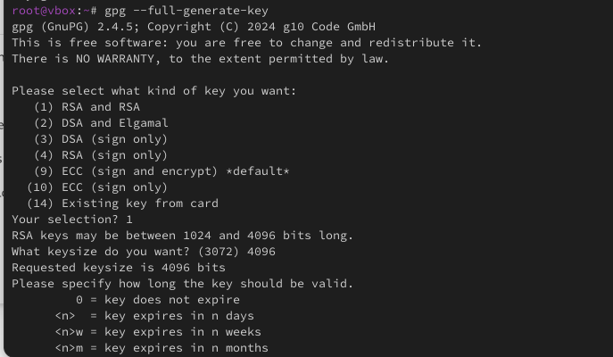
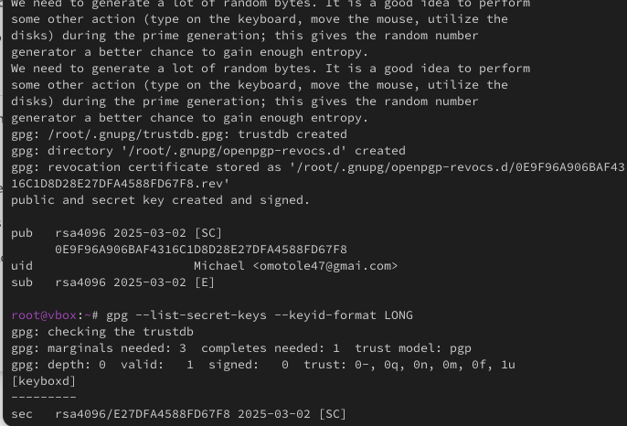
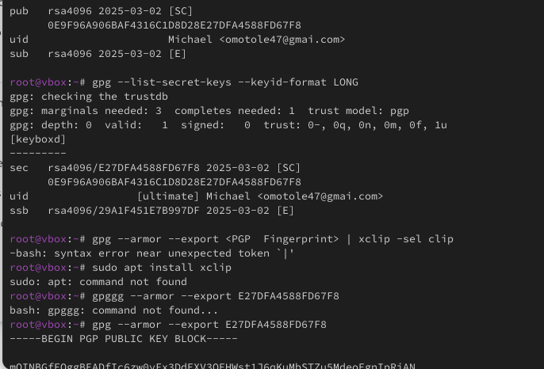
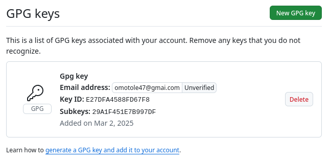

# Информация

## Докладчик

* Давид Майкл Фрэнсис
* Студент направления «Математика и компьютерные науки»
* Российский университет дружбы народов
* <https://ushie47.github.io/blog>

# Вводная часть

## Актуальность

* Системы контроля версий — неотъемлемый инструмент разработки ПО.
* Позволяют отслеживать историю изменений и работать совместно.
* Git лежит в основе большинства современных рабочих процессов разработки и работы с GitHub.

## Цель работы

Изучить идеологию и применение средств контроля версий, освоить умения по работе с Git.

## Задание

1. Установить Git и GitHub CLI (gh).
2. Настроить пользовательские данные и кодировку вывода Git.
3. Создать SSH-ключ для аутентификации.
4. Создать PGP-ключ и настроить подпись коммитов.
5. Добавить PGP-ключ в учётную запись GitHub.
6. Настроить структуру рабочего каталога курса.

# Выполнение работы

## Установка Git и GitHub CLI

Я установил Git и GitHub CLI с помощью менеджера пакетов `dnf`.



## Настройка Git и создание SSH-ключа

Я указал имя и почту для коммитов, настроил вывод сообщений в UTF-8, включил проверку и подпись коммитов и создал SSH-ключ.



## Генерация PGP-ключа

Я сгенерировал PGP-ключ командой `gpg --full-generate-key`.



## Добавление PGP-ключа в GitHub (шаг 1)

Я добавил сгенерированный ключ в учётную запись GitHub через настройки профиля.



## Добавление PGP-ключа в GitHub (шаг 2)



## Добавление PGP-ключа в GitHub (шаг 3)



## Автоматическая подпись коммитов

Я настроил Git на автоматическую подпись коммитов сгенерированным PGP-ключом:

```bash
git config --global user.signingkey <PGP Fingerprint>
git config --global commit.gpgsign true
git config --global gpg.program $(which gpg2)
