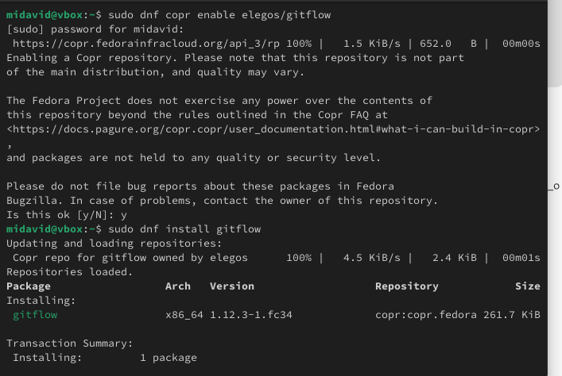
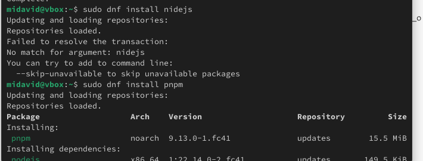
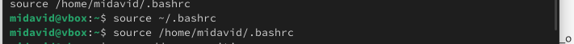
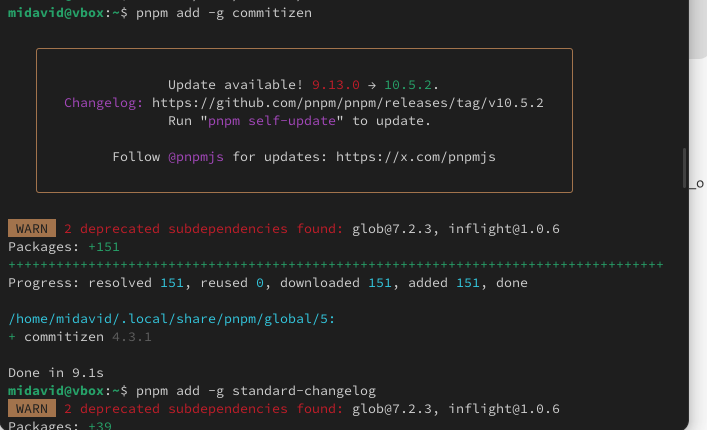
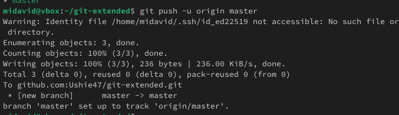
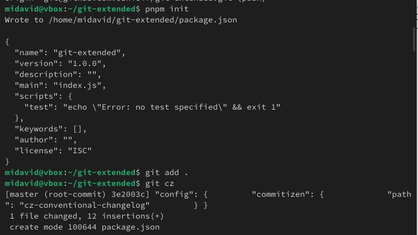

# Информация

## Докладчик

* Давид Майкл Фрэнсис
* Студент направления «Математика и компьютерные науки»
* Российский университет дружбы народов
* <https://ushie47.github.io/blog>

# Вводная часть

## Актуальность

* Важность единого и предсказуемого процесса управления ветками и релизами в командной разработке.
* Модель git-flow задаёт чёткую структуру веток (основная, разрабатываемая, функциональные, релизные).
* Сочетание с автоматизированным версионированием и генерацией журнала изменений.

## Цель работы

Получение навыков правильной работы с репозиториями Git.

## Задание

1. Установить git-flow из репозитория COPR.
2. Установить Node.js и настроить окружение для семантического версионирования.
3. Установить вспомогательные утилиты commitizen и standard-changelog.
4. Подключить локальный репозиторий к GitHub.
5. Инициализировать и настроить модель git-flow.
6. Создать релиз версии 1.0.0 с журналом изменений и опубликовать его на GitHub.
7. Отработать создание функциональной ветки и релиза версии 1.2.3.

# Выполнение работы

## Установка git-flow

Я установил git-flow из репозитория COPR.



## Установка Node.js и настройка PATH

Был установлен Node.js, а в переменную `PATH` добавлена директория с исполняемыми файлами.



## Настройка PATH для Node.js



## Установка commitizen и standard-changelog

С помощью пакетного менеджера `pnpm` были установлены утилиты для форматирования коммитов и генерации журнала изменений.



## Подключение репозитория к GitHub

Репозиторий был подключён к GitHub, сделан первый коммит и выполнена его отправка.



## Конфигурация коммитов для Node.js

Выполнена общая конфигурация коммитов с инициализацией через PNPM.



## Выполнение релизного цикла (версия 1.0.0)

Настроена модель git-flow, сформирован журнал изменений и создан релиз на GitHub.

```bash
git flow init
git flow release start 1.0.0
standard-changelog --first-release
git flow release finish 1.0.0
gh release create v1.0.0 -F CHANGELOG.md
