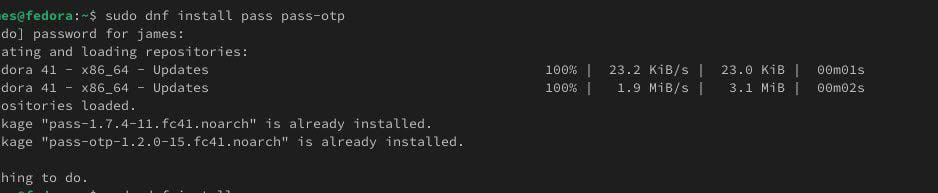
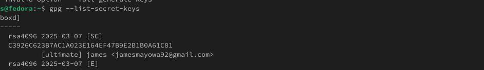
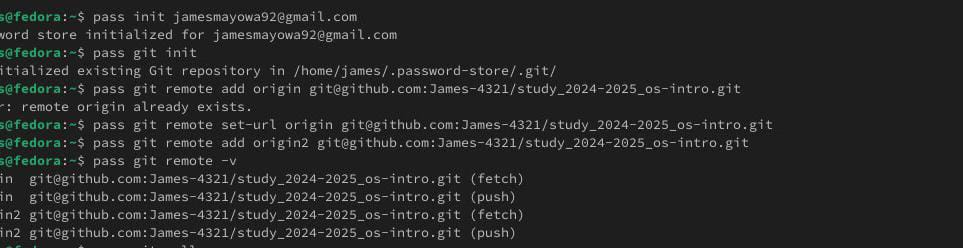
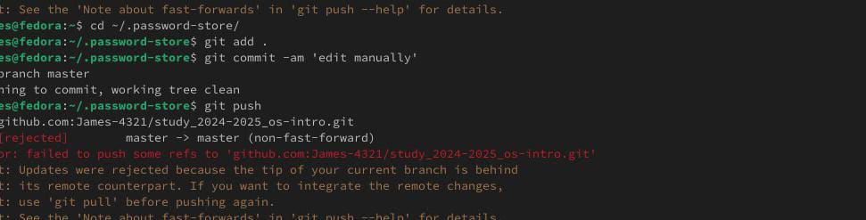
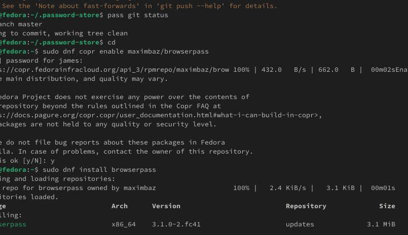
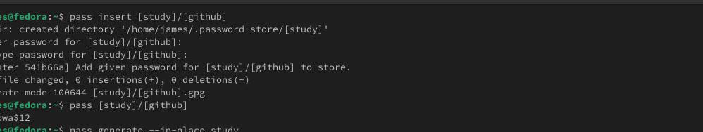
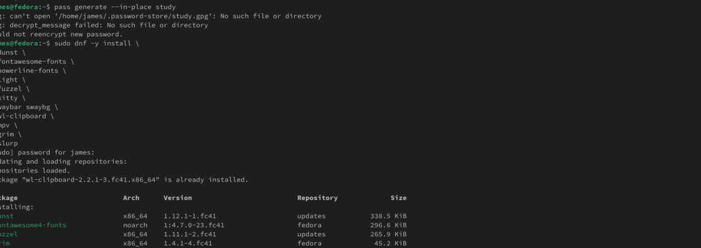
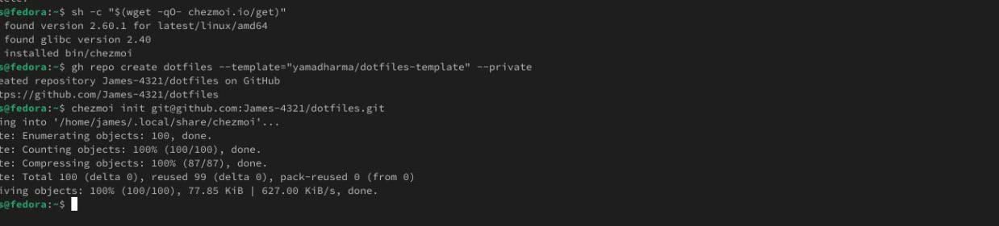
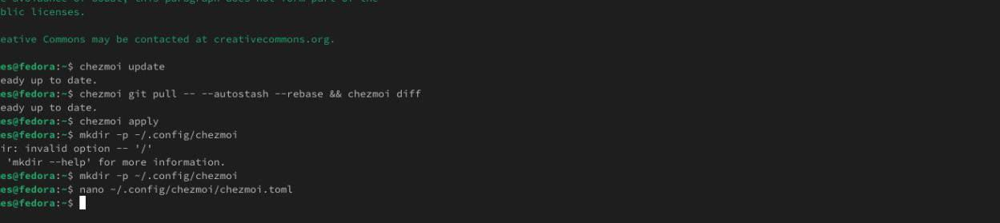

# Информация

## Докладчик

* Давид Майкл Фрэнсис
* Студент направления «Математика и компьютерные науки»
* Российский университет дружбы народов
* <https://ushie47.github.io/blog>

# Вводная часть

## Актуальность

* Безопасное хранение паролей и единообразное управление конфигурационными файлами (dotfiles) на нескольких машинах.
* Использование менеджера паролей `pass` на основе шифрования GPG и версионирования через Git.
* Применение утилиты `chezmoi` для безопасной и воспроизводимой настройки рабочего окружения.

## Цель работы

Научиться пользоваться менеджером паролей и Chezmoi.

## Задание

1. Установить и настроить менеджер паролей `pass` и `gopass`.
2. Просмотреть список доступных GPG-ключей.
3. Инициализировать хранилище паролей и синхронизировать его с git-репозиторием.
4. Настроить ручную фиксацию изменений и браузерный интерфейс BrowserPass.
5. Сохранить и отобразить пароль с помощью `pass`.
6. Установить и настроить Chezmoi для управления dotfiles.
7. Настроить автоматическую фиксацию и отправку изменений в репозиторий.

# Выполнение работы

## Установка pass, pass-otp и gopass

Я установил необходимые менеджеры паролей с помощью менеджера пакетов `dnf`.

{#fig-001 width=70%}

## Просмотр GPG-ключей

Я просмотрел список имеющихся GPG-ключей командой `gpg --list-secret-keys`.

{#fig-003 width=70%}

## Инициализация хранилища паролей

Хранилище паролей было инициализировано с привязкой к GPG-ключу и синхронизировано с удалённым git-репозиторием.

{#fig-004 width=70%}

## Ручная фиксация изменений

При прямом редактировании файловой системы хранилища изменения фиксируются и отправляются вручную.

{#fig-006 width=70%}

## Установка BrowserPass

Для работы с паролями непосредственно в браузере был установлен плагин BrowserPass.

{#fig-007 width=70%}

## Сохранение и отображение пароля

Я создал пароль и выполнил его отображение для конкретной записи в терминале.

{#fig-008 width=70%}

## Установка Chezmoi

Для управления конфигурационными файлами были установлены необходимые утилиты и бинарный файл Chezmoi.

{#fig-009 width=70%}

## Создание репозитория dotfiles

Был создан собственный репозиторий для конфигурационных файлов на основе шаблона и выполнена инициализация Chezmoi.

{#fig-010 width=70%}

## Автоматическая фиксация изменений

Для автоматической фиксации и отправки изменений в файл конфигурации `chezmoi.toml` были добавлены соответствующие параметры.

{#fig-011 width=70%}

# Результаты

## Выводы

::: {.nonincremental}

- Установлены и настроены менеджеры паролей `pass` и `gopass`.
- Хранилище паролей инициализировано, привязано к GPG-ключу и синхронизировано с удалённым git-репозиторием.
- Настроены ручная фиксация изменений хранилища и браузерный интерфейс BrowserPass.
- Сохранён и успешно отображён пароль через `pass`.
- Установлен Chezmoi, создан личный репозиторий dotfiles и настроена автоматическая синхронизация.

:::

# Заключение

## Спасибо за внимание!

* **Докладчик:** Давид Майкл Фрэнсис
* **Блог:** <https://ushie47.github.io/blog>
* **GitHub:** <https://github.com/ushie47>
