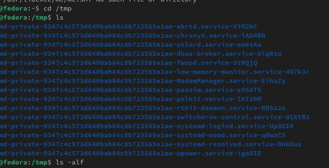
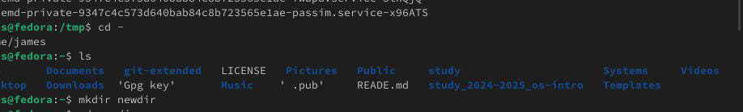
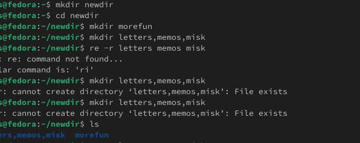
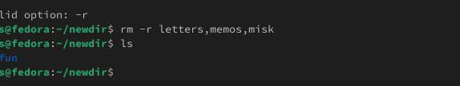
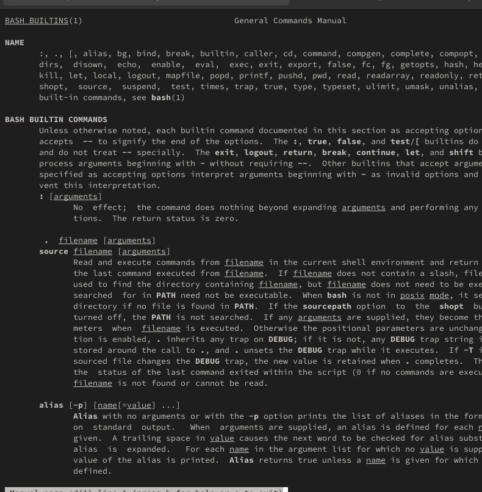
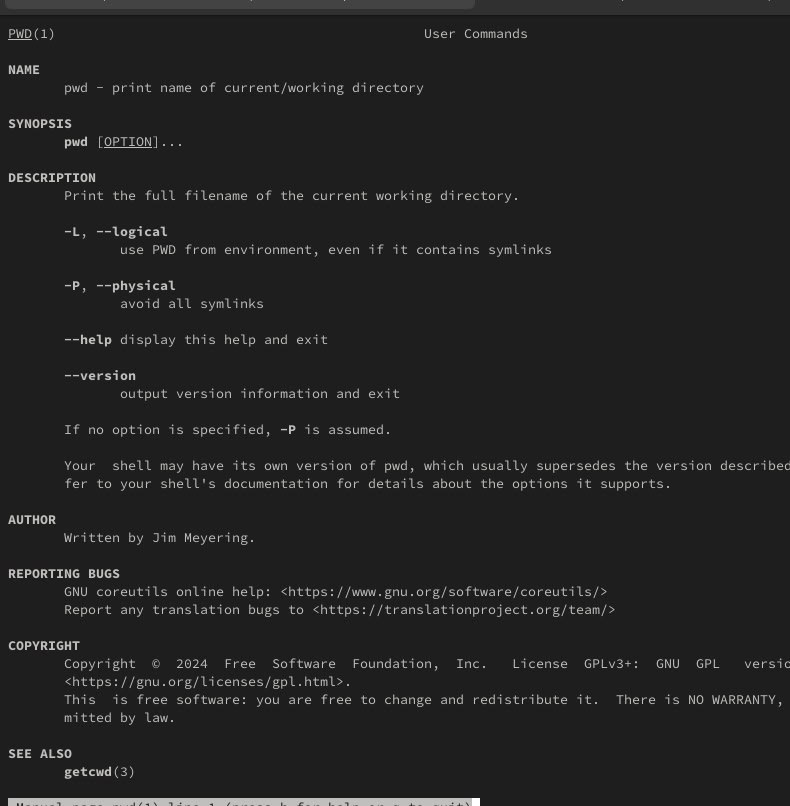
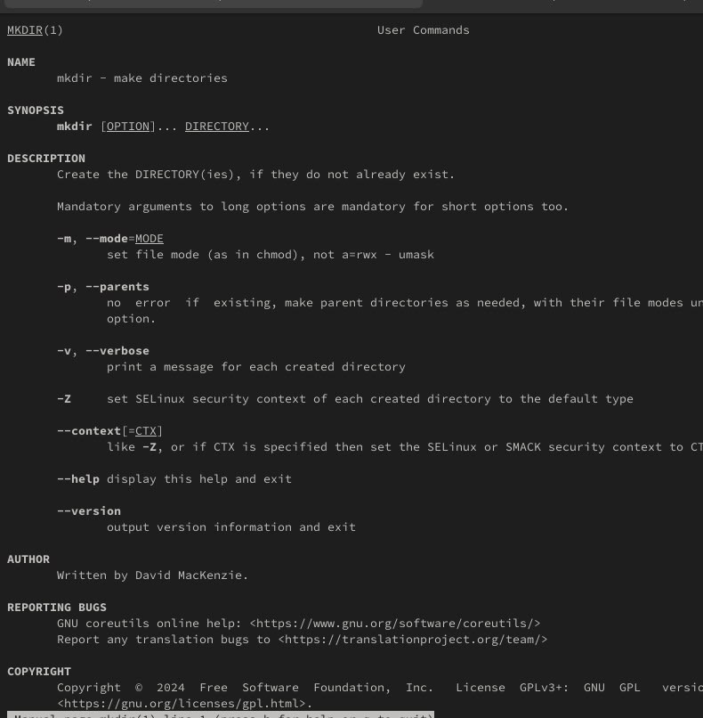
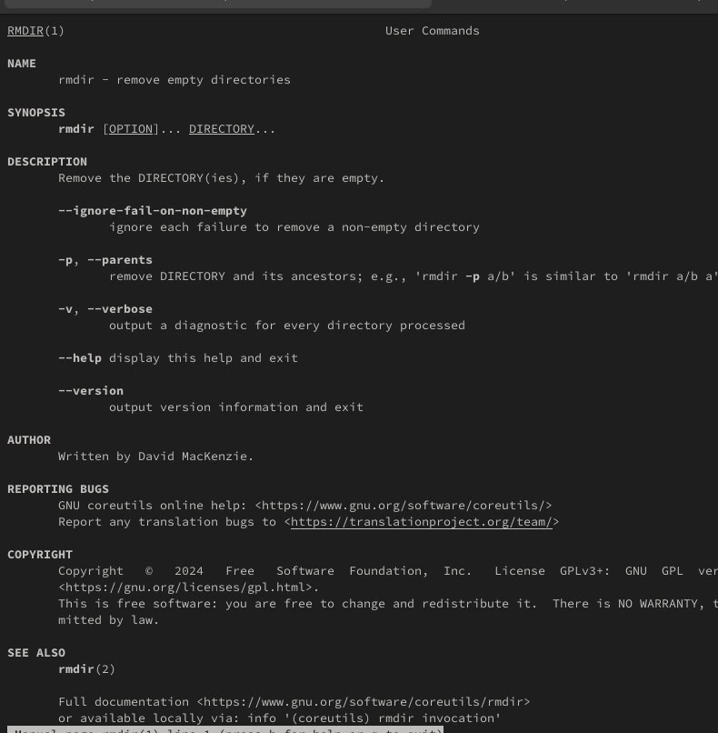
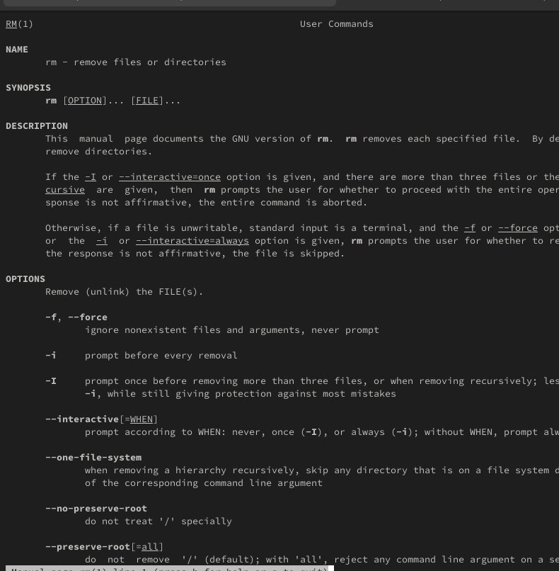
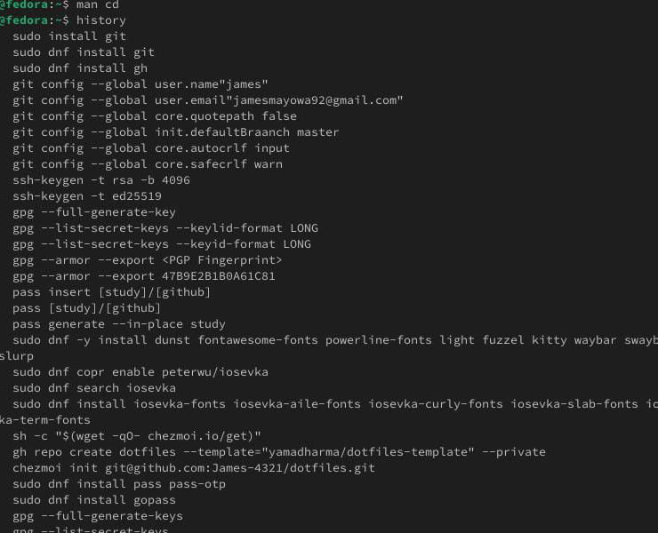

# Информация

## Докладчик

* Давид Майкл Фрэнсис
* Студент направления «Математика и компьютерные науки»
* Российский университет дружбы народов
* <https://ushie47.github.io/blog>

# Вводная часть

## Актуальность

* Уверенное владение командной строкой — базовый навык при работе с Linux.
* Навигация по файловой системе и управление каталогами необходимы для администрирования и автоматизации.
* Получение справочной информации о командах ускоряет освоение системы.

## Цель работы

Приобретение практических навыков взаимодействия пользователя с системой посредством командной строки.

## Задание

1. Определить полный путь домашнего каталога пользователя.
2. Выполнить навигацию в каталог `/tmp` и просмотреть его содержимое с помощью `ls`.
3. Вернуться в домашний каталог и просмотреть его содержимое.
4. Создать и удалить каталоги (в том числе несколько каталогов одной командой).
5. С помощью `man` найти опции `ls` для рекурсивного просмотра и сортировки по времени.
6. Изучить описания команд `cd`, `pwd`, `mkdir`, `rmdir`, `rm` через `man`.
7. Использовать историю команд для модификации и повторного исполнения.

# Выполнение работы

## Навигация и просмотр каталогов

Я определил путь домашнего каталога, перешёл в каталог `/tmp` и вывел его содержимое с различными опциями `ls`.

{#fig-001 width=70%}

## Просмотр домашнего каталога

После возвращения в домашний каталог я вывел его содержимое на экран.

{#fig-002 width=70%}

## Создание и удаление каталогов

В домашнем каталоге были созданы каталоги `newdir` и `morefun`, а также создана и удалена группа каталогов одной командой.

{#fig-003 width=70%}

## Групповое создание и удаление каталогов

{#fig-004 width=70%}

## Использование руководства (man)

С помощью команды `man ls` были определены опции для рекурсивного просмотра подкаталогов и сортировки по времени.

{#fig-005 width=70%}

## Изучение справочных страниц команд

Я изучил описания базовых команд с помощью встроенной справки `man`.

{#fig-006 width=70%}

## Справка команды pwd

{#fig-007 width=70%}

## Справка команды mkdir

{#fig-008 width=70%}

## Справка команды rmdir

{#fig-009 width=70%}

## Работа с историей команд

Используя механизм истории (`history`), я выполнил модификацию и повторное исполнение команд из буфера.

{#fig-010 width=70%}

# Результаты

## Выводы

::: {.nonincremental}

- Определен полный путь домашнего каталога и отработана навигация по файловой системе.
- Созданы и удалены одиночные и множественные каталоги.
- С помощью `man` найдены нужные опции команды `ls`.
- Изучены справочные руководства для базовых команд управления файлами и каталогами.
- Отработано использование истории команд для повторного запуска.

:::

# Заключение

## Спасибо за внимание!

* **Докладчик:** Давид Майкл Фрэнсис
* **Блог:** <https://ushie47.github.io/blog>
* **GitHub:** <https://github.com/ushie47>
