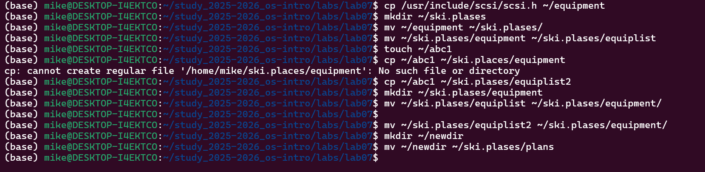
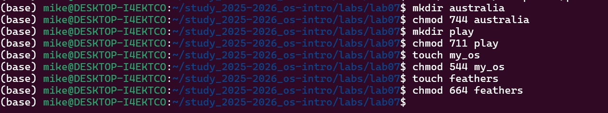

# Информация

## Докладчик

* Давид Майкл Фрэнсис
* Студент направления «Математика и компьютерные науки»
* Российский университет дружбы народов
* <https://ushie47.github.io/blog>

# Вводная часть

## Актуальность

* Понимание структуры файловой системы Linux и владение командами работы с файлами и каталогами.
* Управление правами доступа для обеспечения безопасности многопользовательской системы.
* Использование команд анализа и обслуживания файловой системы для контроля состояния дисков.

## Цель работы

Ознакомление с файловой системой Linux, её структурой, приобретение практических навыков работы с файлами, каталогами, правами доступа и средствами обслуживания файловой системы.

## Задание

1. Изучить структуру файловой системы Linux и назначение каталогов первого уровня.
2. Освоить команды работы с файлами и каталогами (`touch`, `cat`, `less`, `head`, `tail`, `cp`, `mv`).
3. Освоить управление правами доступа с помощью команды `chmod`.
4. На практике проверить влияние прав доступа на выполнение операций.
5. Изучить команды анализа и обслуживания файловой системы (`mount`, `df`, `fsck`, `mkfs`, `lsblk`).

# Выполнение работы

## Работа с файлами и каталогами

В домашнем каталоге был создан файл `abc1` и созданы различные копии и структуры каталогов для отработки команд `cp` и `mv`.

{#fig-001 width=70%}

## Изменение и проверка прав доступа

Для экспериментов с правами доступа были созданы каталоги и файлы, права которых были изменены через `chmod`.

{#fig-002 width=70%}

## Проверка влияния прав доступа

* У владельца файла `feathers` отзывалось право чтения, что приводило к ошибке `Permission denied` при попытке чтения или копирования.
* У владельца каталога `play` отзывалось право выполнения, блокирующее переход в данный каталог.

## Обслуживание файловой системы

С помощью утилит `mount`, `fsck`, `mkfs`, `df` и `lsblk` были рассмотрены вопросы проверки и обслуживания файловой системы.

# Результаты

## Выводы

::: {.nonincremental}

- Изучена структура файловой системы Linux и каталоги первого уровня.
- Отработаны команды управления файлами, каталогами и проверки дискового пространства.
- Проверена модель прав доступа и её влияние на доступ к файлам и каталогам.
- Рассмотрены базовые команды обслуживания файловой системы (`mount`, `fsck`, `mkfs`, `df`, `lsblk`).

:::

# Заключение

## Спасибо за внимание!

* **Докладчик:** Давид Майкл Фрэнсис
* **Блог:** <https://ushie47.github.io/blog>
* **GitHub:** <https://github.com/ushie47>
