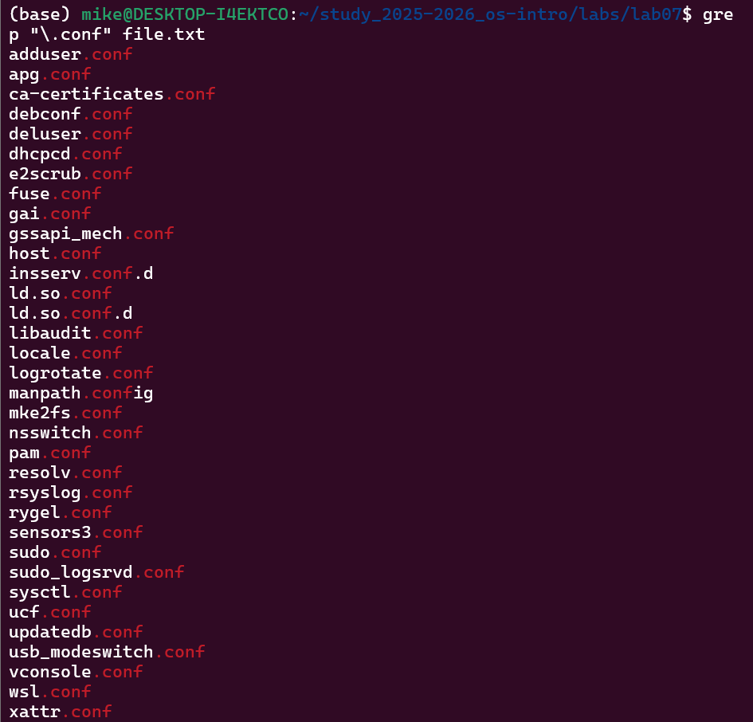
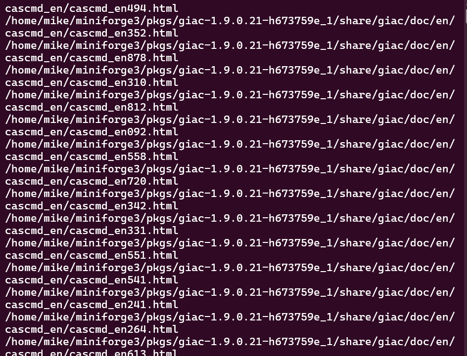
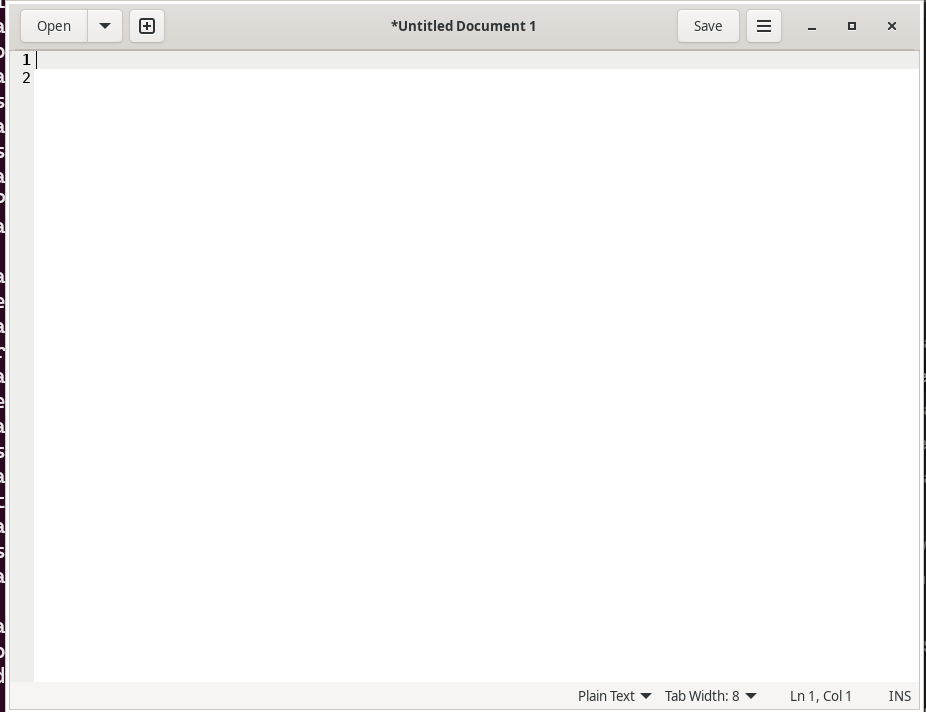
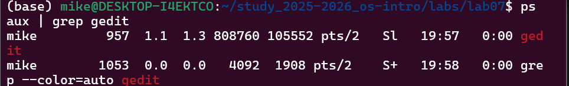
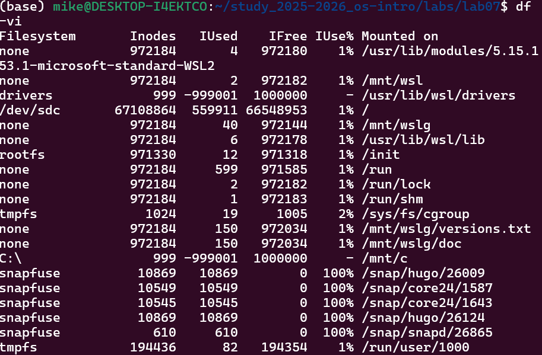

# Информация

## Докладчик

* Давид Майкл Фрэнсис
* Студент направления «Математика и компьютерные науки»
* Российский университет дружбы народов
* <https://ushie47.github.io/blog>

# Вводная часть

## Актуальность

* Перенаправление ввода-вывода, конвейеры и инструменты поиска файлов составляют основу эффективной работы в командной строке Linux.
* Управление процессами и фоновыми задачами — повседневные практические задачи администрирования.
* Контроль использования дискового пространства необходим для стабильной работы в многозадачной среде.

## Цель работы

Ознакомление с инструментами поиска файлов и фильтрации текстовых данных, приобретение навыков управления процессами, фоновыми задачами и проверки использования диска.

## Задание

1. Изучить потоки ввода-вывода и операторы их перенаправления.
2. Освоить использование конвейеров для объединения команд.
3. Освоить поиск файлов с помощью `find` и фильтрацию текста с помощью `grep`.
4. Управлять процессами и фоновыми задачами (`ps`, `kill`, `jobs`, `pgrep`).
5. Освоить проверку использования диска командами `df` и `du`.

# Выполнение работы

## Перенаправление ввода-вывода

Содержимое каталога `/etc` было записано в файл `file.txt`, а содержимое домашнего каталога — дописано в него же.

{#fig-001 width=70%}

## Поиск файлов

Файлы домашнего каталога, начинающиеся с символа `c`, были найдены с помощью `find`, подстановки имён файлов и `echo`.

{#fig-002 width=70%}

## Использование конвейеров

Файлы каталога `/etc`, начинающиеся с `h`, выводились постранично через конвейер.

{#fig-003 width=70%}

## Управление фоновыми процессами

В фоновом режиме был запущен редактор `gedit` для дальнейшего управления через утилиты `ps`, `pgrep` и `kill`.

{#fig-004 width=70%}

## Определение PID процесса

Идентификатор процесса `gedit` был определён через `ps` и `pgrep`.

{#fig-005 width=70%}

## Проверка использования диска

С помощью утилит `df` и `du` было проверено использование дискового пространства.

{#fig-006 width=70%}

# Результаты

## Выводы

::: {.nonincremental}

- Отработаны операторы перенаправления вывода и использование конвейеров.
- Освоена фильтрация текста с помощью `grep` и поиск файлов через `find`.
- Исследованы фоновые задачи, определены PID процессов и выполнены их завершения.
- Проверено использование дискового пространства и размер домашнего каталога.

:::

# Заключение

## Спасибо за внимание!

* **Докладчик:** Давид Майкл Фрэнсис
* **Блог:** <https://ushie47.github.io/blog>
* **GitHub:** <https://github.com/ushie47>
