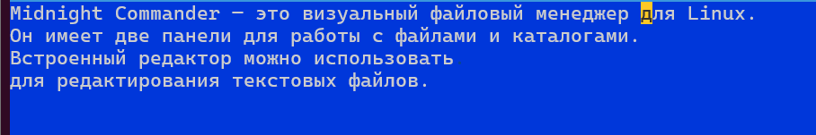
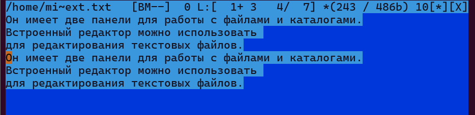

# Информация

## Докладчик

* Давид Майкл Фрэнсис
* Студент направления «Математика и компьютерные науки»
* Российский университет дружбы народов
* <https://ushie47.github.io/blog>

# Вводная часть

## Актуальность

* Графические командные оболочки, такие как Midnight Commander, упрощают работу с файловой системой в UNIX/Linux-окружении.
* Предоставляют интуитивно понятный интерфейс для типичных файловых операций без необходимости запоминания сложных команд shell.

## Цель работы

Освоение основных возможностей командной оболочки Midnight Commander, приобретение навыков работы с каталогами, файлами и встроенным редактором.

## Задание

1. Изучить структуру интерфейса Midnight Commander.
2. Освоить основные функциональные клавиши и комбинации клавиш.
3. Научиться управлять панелями и режимами их отображения.
4. Освоить работу со встроенным редактором mcedit.
5. Выполнить практические операции с файлами и каталогами.

# Выполнение работы

## Запуск Midnight Commander

Для запуска Midnight Commander используется команда `mc`.

{#fig-001 width=70%}

## Управление панелями и меню

* Переключение между панелями выполняется клавишей `Tab`.
* Вызов главного меню осуществляется клавишей `F9`.
* Управление отображением панелей выполняется через комбинации `Ctrl-u`, `Ctrl-o` и `Ctrl-x d`.

## Основные файловые операции

* `F3` — просмотр содержимого файла.
* `F4` — редактирование файла.
* `F5` — копирование файла или каталога.
* `F6` — перемещение или переименование.
* `F7` — создание нового каталога.
* `F8` — удаление файла или каталога.

## Работа со встроенным редактором mcedit

* Редактор открывается клавишей `F4`.
* Поддерживает работу с текстом и исходным кодом, включая подсветку синтаксиса.
* Основные команды: `F2` (сохранить), `F10` (выход), `Ctrl-y` (удалить строку), `Ctrl-u` (отмена).

{#fig-002 width=70%}

# Результаты

## Выводы

::: {.nonincremental}

- Освоен интерфейс и основные функциональные клавиши Midnight Commander.
- Выполнены практические операции по управлению файлами и каталогами.
- Настроены панели и изучены возможности меню mc.
- Освоена работа со встроенным редактором mcedit для редактирования файлов.

:::

# Заключение

## Спасибо за внимание!

* **Докладчик:** Давид Майкл Фрэнсис
* **Блог:** <https://ushie47.github.io/blog>
* **GitHub:** <https://github.com/ushie47>
