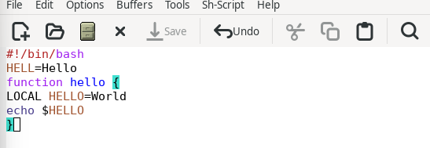

# Информация

## Докладчик

* Давид Майкл Фрэнсис
* Студент направления «Математика и компьютерные науки»
* Российский университет дружбы народов
* <https://ushie47.github.io/blog>

# Вводная часть

## Актуальность

* Emacs — один из старейших и наиболее функциональных текстовых редакторов для Linux.
* Применяется для редактирования текста, программирования и администрирования систем.
* Владение базовыми приёмами работы остаётся востребованным навыком в средах без графического интерфейса.

## Цель работы

Познакомиться с операционной системой Linux и получить практические навыки работы с редактором Emacs.

## Задание

1. Создать и сохранить файл скрипта с помощью Emacs.
2. Освоить базовые операции редактирования текста (вырезание, вставка, копирование, отмена).
3. Освоить выделение текстовой области и перемещение курсора.
4. Освоить управление буферами Emacs и разделение фрейма на окна.
5. Освоить режимы поиска текста, поиска с заменой и режим `occur`.

# Выполнение работы

## Создание и редактирование файла

* Файл `lab07.sh` был создан командой `C-x C-f`, а текст скрипта сохранён командой `C-x C-s`.
* Отработаны базовые операции: вырезание строки (`C-k`), вставка (`C-y`), копирование через kill-ring (`M-w`) и отмена действия (`C-/`).

## Управление буферами и окнами

* Список буферов вызывается командой `C-x C-b`, переключение между ними — `C-x b`, а закрытие окна — `C-x 0`.
* Фрейм был разделён на несколько частей: вертикальное (`C-x 3`) и горизонтальное (`C-x 2`) разделение для одновременной работы в четырёх окнах.

## Поиск текста

* Протестированы инкрементальный поиск (`C-s`), поиск с заменой (`M-%`) и режим `occur` (`M-s o`) для вывода всех совпадений в отдельный буфер.

{#fig-001 width=70%}

# Результаты

## Выводы

::: {.nonincremental}

- Создан и отредактирован файл скрипта в Emacs.
- Отработаны операции редактирования, выделения и перемещения курсора.
- Освоено управление буферами и разделение фрейма на окна.
- Опробованы различные режимы поиска текста и режим `occur`.

:::

# Заключение

## Спасибо за внимание!

* **Докладчик:** Давид Майкл Фрэнсис
* **Блог:** <https://ushie47.github.io/blog>
* **GitHub:** <https://github.com/ushie47>
