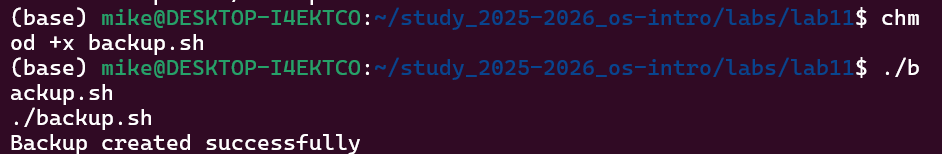
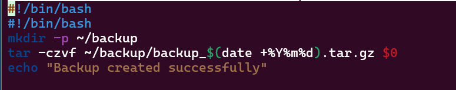
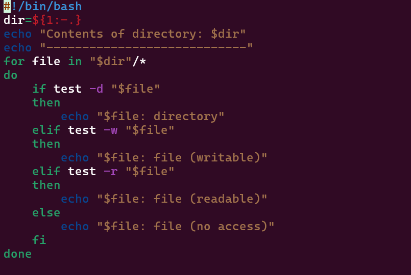
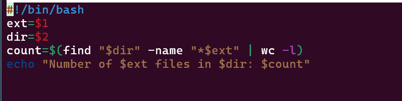

# Информация

## Докладчик

* Давид Майкл Фрэнсис
* Студент направления «Математика и компьютерные науки»
* Российский университет дружбы народов
* <https://ushie47.github.io/blog>

# Вводная часть

## Актуальность

* Написание командных файлов (скриптов) — базовый навык автоматизации задач в Linux.
* Использование скриптов bash позволяет объединять привычные команды для решения рутинных задач.
* Автоматизация резервного копирования и анализа файловой системы повышает эффективность работы.

## Цель работы

Изучить основы программирования в оболочке ОС UNIX/Linux и научиться писать небольшие командные файлы.

## Задание

1. Изучить основы написания скриптов bash.
2. Написать скрипт резервного копирования с использованием `tar` и текущей даты.
3. Написать скрипт обработки произвольного числа аргументов.
4. Написать скрипт — аналог команды `ls` для определения типов и прав файлов.
5. Написать скрипт подсчёта файлов по расширению.

# Выполнение работы

## Скрипт резервного копирования (backup.sh)

Скрипт архиврует сам себя в каталог `~/backup` с текущей датой в имени файла.

{#fig-001 width=70%}

## Результат выполнения backup.sh

{#fig-002 width=70%}

## Обработка аргументов (args.sh)

Скрипт последовательно выводит все переданные аргументы командной строки с помощью цикла `for`.

{#fig-003 width=70%}

## Аналог команды ls (myls.sh)

Скрипт выводит содержимое каталога и определяет тип и доступность файлов без вызова `ls`.

{#fig-005 width=70%}

## Подсчёт файлов по расширению (countfiles.sh)

Скрипт принимает расширение и путь, подсчитывая количество файлов заданного типа.

{#fig-007 width=70%}

# Результаты

## Выводы

::: {.nonincremental}

- Разработан скрипт резервного копирования с датой в архиве.
- Написан скрипт обработки произвольного числа параметров через `$@`.
- Реализован аналог команды `ls` на базе условных операторов и команды `test`.
- Создан скрипт для подсчёта файлов по расширению через `find` и `wc`.

:::

# Заключение

## Спасибо за внимание!

* **Докладчик:** Давид Майкл Фрэнсис
* **Блог:** <https://ushie47.github.io/blog>
* **GitHub:** <https://github.com/ushie47>
