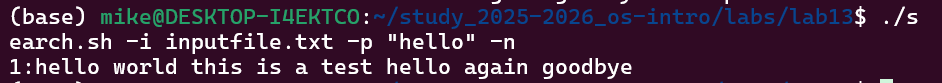
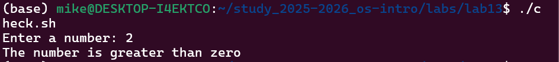
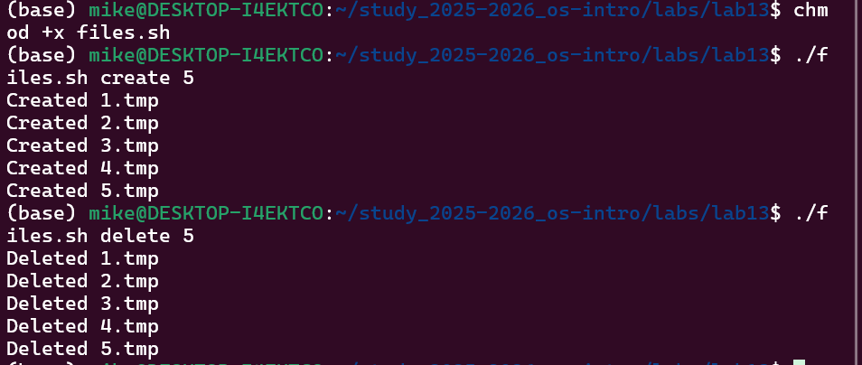

# Информация

## Докладчик

* Давид Майкл Фрэнсис
* Студент направления «Математика и компьютерные науки»
* Российский университет дружбы народов
* <https://ushie47.github.io/blog>

# Вводная часть

## Актуальность

* Управляющие конструкции ветвления и циклов необходимы для усложнения задач автоматизации.
* Разбор параметров командной строки важен для создания полезных инструментов.
* Конструкции bash расширяют базовые навыки написания скриптов.

## Цель работы

Изучить основы программирования в оболочке ОС UNIX и научиться писать более сложные командные файлы с использованием логических управляющих конструкций и циклов.

## Задание

1. Изучить команду `getopts` для разбора именованных параметров командной строки.
2. Написать скрипт анализа аргументов и поиска текста с помощью `grep`.
3. Написать программу на языке Си и командный файл, анализирующий код её завершения.
4. Написать скрипт создания и удаления файлов в цикле.
5. Написать скрипт архивации файлов, в том числе по критерию времени последнего изменения.

# Выполнение работы

## Использование getopts и grep

* Скрипт `search.sh` анализирует командную строку с ключами `-i`, `-o`, `-p`, `-C` и `-n`.
* Выполняет поиск в указанном файле с помощью команды `grep`.

{#fig-001 width=70%}

## Программа на Си и код завершения

* Программа `check_number.c` считывает число, определяет его знак и завершается через `exit(n)`.
* Командный файл `check.sh` запускает программу и анализирует код завершения через переменную `$?`.

{#fig-002 width=70%}

## Создание и удаление файлов

* Скрипт `files.sh` принимает действие (`create` или `delete`) и число `N`.
* Создаёт или удаляет файлы с расширением `.tmp` в цикле `for`.

{#fig-003 width=70%}

## Архивация файлов

* Скрипт `archive.sh` архивирует все файлы в директории с помощью `tar`.
* Отдельно архивирует файлы, изменённые менее недели назад, с помощью `find` и `tar -T -`.

# Результаты

## Выводы

::: {.nonincremental}

- Разработан скрипт с разбором ключей через `getopts`.
- Реализовано взаимодействие программы на Си и bash-скрипта через коды завершения.
- Написан скрипт автоматического создания и удаления файлов в цикле.
- Создан скрипт архивации по критерию времени изменения.

:::

# Заключение

## Спасибо за внимание!

* **Докладчик:** Давид Майкл Фрэнсис
* **Блог:** <https://ushie47.github.io/blog>
* **GitHub:** <https://github.com/ushie47>
