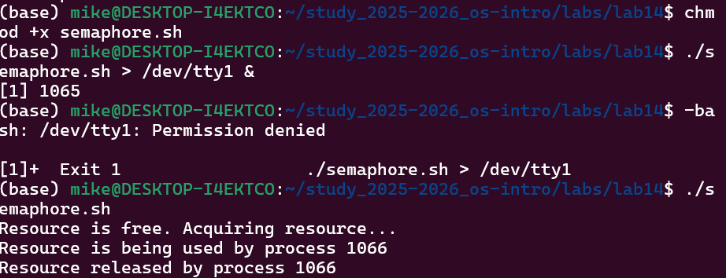
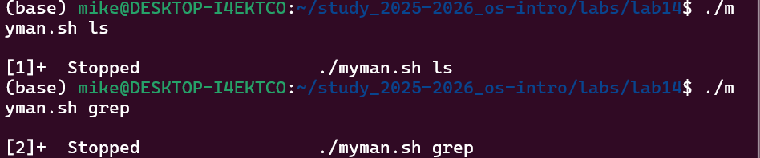
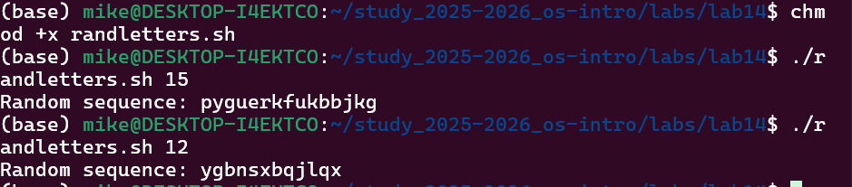

# Информация

## Докладчик

* Давид Майкл Фрэнсис
* Студент направления «Математика и компьютерные науки»
* Российский университет дружбы народов
* <https://ushie47.github.io/blog>

# Вводная часть

## Актуальность

* Поиск специфичных приёмов администрирования и автоматизации в Linux помимо базовых управляющих конструкций.
* Синхронизация доступа процессов к общему ресурсу, программное обращение к man и генерация псевдослучайных данных.
* Расширение набора инструментов программирования в командной оболочке bash.

## Цель работы

Изучить основы программирования в оболочке ОС UNIX и научиться писать более сложные командные файлы.

## Задание

1. Реализовать упрощённый механизм семафоров для синхронизации доступа к общему ресурсу.
2. Написать аналог команды `man` для просмотра справки по командам.
3. Написать генератор случайной последовательности букв с использованием переменной `$RANDOM`.

# Выполнение работы

## Упрощённый механизм семафоров

* Скрипт `semaphore.sh` реализует синхронизацию доступа к общему ресурсу через файл-блокировку.
* Ожидание освобождения ресурса в течение времени `t1` и использование ресурса в течение `t2`.

{#fig-001 width=70%}

## Аналог команды man

* Скрипт `myman.sh` принимает название команды и выводит справку из каталога `/usr/share/man/man1`.
* Проверяет наличие соответствующего файла справочной страницы.

{#fig-002 width=70%}

## Генератор случайных букв

* Скрипт `randletters.sh` генерирует случайную последовательность латинских букв с помощью переменной `$RANDOM`.
* Длина последовательности передаётся в качестве аргумента командной строки.

{#fig-003 width=70%}

# Результаты

## Выводы

::: {.nonincremental}

- Реализован упрощённый механизм семафоров для синхронизации процессов.
- Написан программный аналог команды `man` для поиска и просмотра справки.
- Создан генератор случайной последовательности букв на основе переменной `$RANDOM`.

:::

# Заключение

## Спасибо за внимание!

* **Докладчик:** Давид Майкл Фрэнсис
* **Блог:** <https://ushie47.github.io/blog>
* **GitHub:** <https://github.com/ushie47>
